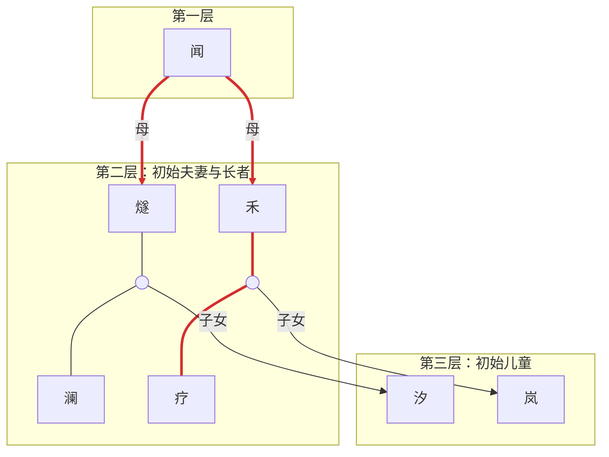

# 泥与水之间 · v0.14.1

## 一个长江下游小族群的纸面模型

这是一个策略文字冒险。玩家带领一个约二十多人的地方群体，在低丘、河湾、湖沼和河口之间生活，争取形成能够跨代维持的生活方式。

每局以达成**结局条件**为目标，但本版改为**一季结算一次时间、年龄、分娩和孕育**：

- 每季结束，所有在世人物年龄 **+1.25 岁**；
- 每代四季，因此一代仍为 **5 年**；
- 寿命、成年、衰弱和死亡不再等到代末一次性结算。

本版沿用初始 24 人名册和五地点地图；年龄按 1.25 递增，记录到两位小数。

---

## v0.14.1 当前规则摘要

### 目标与结局

- 基础 HE 要求六项过渡条件至少满足五项、至少两张知识完整、除看家狗外全部资源 ≥1；再以“有人接火、有人来往、能熬过坏年景”三项见证判定普通 HE 或真 HE。
- 基础 HE 优先于非 HE 路线。基础 HE 未成立时，第 6 代起可进入水泽共生、逐潮而居、行水为家、两岸同灶、山脊火种、孩子的火塘、孤岸丰年或生存结局。
- 结局不是道德评分；“连续两代”均指两个已完成结算的代末状态。
- 逐潮而居读取累计河口代次、河口生计和成功跨群体往来；行水为家读取不同水网营地数量与能讲述路线的成年传承者。

### 本版关键规则

1. 每季固定先随机事件、再营地迁徙、最后行动；事件在行动选择前公开。
2. 每张知识卡有一名当前持有人和两名传承人。未被选为某知识传承人的全体人物，在该知识上默认熟练度 0；只有当前持有人和两张传承位能保留可增长的熟练度。
3. 知识持有人死亡时不再额外给传承人 +1；两名在世传承人中熟练度最高者接任，平手优先成人，只有儿童传承人时由儿童接任；随后立即补足两名传承人。
4. 训练不花食物，但要求食物 ≥3；两名在世传承人同时 +1，当前持有人不因训练提升。
5. 营地迁徙不占行动，一季最多一次：支付 2 食物、储藏 -1、住所 -1，看家狗随队，其余资源不变。河口咸潮与海侵提供一次至内陆的迁徙机会。
6. 橡林或高丘是储藏营地：在当地储藏最低为 1，负面效果不能使储藏低于 1，正面效果仍可提高到上限 3。
7. 早期自动受孕受到食物和照护修正；第 1—3 代需要更高总骰，第 4 代起恢复较低阈值。
8. 连续两代经营芦苇湖沼，可减弱盛夏疾病；连续两代维持照护 ≥2 且照护者在位，每代可保护一次儿童事件。
9. 雷暴与洪水、盟约破裂、长者首次衰弱均提供三选一处理，不再全部自动结算。
10. 全文固定使用“营地迁徙”“人员迁入/迁出”“联盟救援迁入”三类术语。

---

## 1. 核心目标

每代有四个季节：

1. **春水季**：鱼汛、水涨、湿地扩张和洪水。
2. **盛夏季**：高生产力、热病、雷暴与水质风险。
3. **秋收季**：橡子、水生果实、鹿群和储藏。
4. **冬寒季**：燃料、衣物、住所和食物储备。

游戏不设固定代际上限。第 1—5 代只推进生存、人口、资源与知识状态，不判定 HE 或非 HE 路线；生存结局仍可随时发生。从**第 6 代冬寒季结算完毕**起，每代结束进行一次结局判定。未达成任何结局且群体仍然存续，就继续进入下一代。

基础 HE 必须同时满足：

1. 原六项过渡条件中至少满足五项；
2. 五张知识卡中至少两张当前状态为“完整”；
3. 除看家狗外，全部数值资源项均不小于 1。

基础 HE 说明群体已经形成一种能跨代维持的生活方式；这不是“文明胜利”，而是“生活站住了”。

基础 HE 达成时，再读取“有人接火、有人来往、能熬过坏年景”三项见证。满足任意两项，结局升级为**真 HE：水有去处，人也有去处**；否则记为普通 HE。

基础 HE 未成立时，可以转入湖沼定居、河口潮季生计、持续移动、跨群体合流、高地退守、共同抚育、封闭繁荣或消散等非 HE 结局。非 HE 结局不是 HE 的低分替代，而是对“这个群体最终选择了什么生活”的不同回答。

---

## 2. 初始设置

### 初始资源

| 项目 | 初始值 |
|---|---:|
| 人口 | 24（成人 14、儿童 7、长者 3） |
| 食物 | 6 |
| 燃料 | 5 |
| 材料 | 5 |
| 凝聚力 | 5 |
| 照护 | 3 |
| 网络 | 1 |
| 住所 | 2 |
| 衣物/编织物 | 2 |
| 储藏标记 | 1 |
| 看家狗 | 0 |
| 营地 | 河湾营地 |

全体人物健康初始为 6/6。

### 固定亲属线

| 人物 | 性别 | 年龄 | 父母 | 配偶 | 子女 | 角色 |
|---|---|---:|---|---|---|---|
| 闻 | 女 | 45 | — | — | 燧、禾 | 故事/亲属知识 |
| 燧 | 男 | 32 | 母：闻 | 澜 | 汐 | 火/陶知识 |
| 澜 | 女 | 30 | — | 燧 | 汐 | 水/木知识 |
| 汐 | 女 | 5 | 燧、澜 | — | — | 儿童 |
| 禾 | 女 | 26 | 母：闻 | 疗 | 岚 | 植物/季节知识 |
| 疗 | 男 | 24 | — | 禾 | 岚 | 治疗知识 |
| 岚 | 男 | 3 | 禾、疗 | — | — | 儿童 |

燧与禾为兄妹；汐与岚为表亲；澜与疗无血缘。

### 初始 24 人名册

下表是 v0.14 的统一公开名册。人物编号同时作为亲属树中的固定编号使用；开局时逐行填入人物面板。主持人把每名成人或长者的隐藏死亡年龄另外记录在主持人栏，不向普通玩家公开。

| # | 姓名 | 性别 | 年龄 | 辈分 | 父母 | 配偶 | 开局角色 |
|---:|---|---|---:|---:|---|---|---|
| 1 | 闻 | 女 | 45 | 1 | — | — | 故事/亲属知识持有者 |
| 2 | 燧 | 男 | 32 | 2 | 母：闻 | 澜 | 火/陶知识持有者 |
| 3 | 澜 | 女 | 30 | 2 | — | 燧 | 水/木知识持有者 |
| 4 | 汐 | 女 | 5 | 3 | 燧、澜 | — | 儿童 |
| 5 | 禾 | 女 | 26 | 2 | 母：闻 | 疗 | 植物/季节知识持有者 |
| 6 | 疗 | 男 | 24 | 2 | — | 禾 | 治疗/草药知识持有者 |
| 7 | 岚 | 男 | 3 | 3 | 禾、疗 | — | 儿童 |
| 8 | 苇 | 男 | 4 | 3 | 芄、葭 | — | 儿童 |
| 9 | 榆 | 女 | 5 | 3 | 渚、麓 | — | 儿童 |
| 10 | 粟 | 女 | 8 | 3 | 槲、汜 | — | 儿童 |
| 11 | 泥 | 男 | 9 | 3 | 芄、葭 | — | 儿童 |
| 12 | 舟 | 男 | 1 | 3 | 菖、汀 | — | 儿童 |
| 13 | 石 | 男 | 13 | 2 | — | 梾 | 成人 |
| 14 | 梾 | 女 | 14 | 2 | — | 石 | 成人 |
| 15 | 菖 | 男 | 14 | 2 | — | 汀 | 成人 |
| 16 | 汀 | 女 | 16 | 2 | — | 菖 | 成人 |
| 17 | 渚 | 男 | 18 | 2 | — | 麓 | 成人 |
| 18 | 麓 | 女 | 20 | 2 | — | 渚 | 成人 |
| 19 | 汜 | 女 | 22 | 2 | — | 槲 | 成人 |
| 20 | 槲 | 男 | 23 | 2 | — | 汜 | 成人 |
| 21 | 葭 | 女 | 25 | 2 | — | 芄 | 成人 |
| 22 | 芄 | 男 | 32 | 2 | — | 葭 | 成人 |
| 23 | 溱 | 男 | 42 | 2 | — | — | 长者 |
| 24 | 濯 | 女 | 50 | 2 | — | — | 长者 |

初始夫妻为：燧—澜、疗—禾、石—梾、菖—汀、渚—麓、槲—汜、芄—葭。除表中写明的父母外，其余人物开局没有在世父母记录。开局主要照护者和翻译/中间人从五名知识持有者以外的成人中指定，并在人物面板上公开。

### 初始辈分

每名人物必须记录一个整数“辈分”。婚姻不改写个人的血缘辈分。

| 辈分 | 初始人物 |
|---:|---|
| 1 | 闻 |
| 2 | 燧、澜、禾、疗、石、梾、菖、汀、渚、麓、槲、汜、芄、葭、溱、濯 |
| 3 | 汐、岚、苇、榆、粟、泥、舟 |

后续子女人物辈分 = 两位父母中较高的辈分数 +1。  
人员迁入者必须在入族时登记辈分；默认登记为接收其所属家庭或联盟组的同辈，无明确接收家庭时登记为当前最年轻成人辈分。

### 五张知识卡

- **火/陶**：火、陶器、炊煮、燃料。
- **水/木**：水、木作、舟、芦苇和湿地建筑。
- **植物/季节**：季节、橡子、水生果实、野生稻和储藏。
- **故事/亲属**：亲属、训练、调解和外部接触。
- **治疗/草药**：伤口、草药、发热和感染。

每张卡指定一名当前持有人和两名传承人。传承人可以来自儿童、成人或长者，但同一人物在同一时间最多担任一张知识的传承人。开局两名传承人的熟练度均为 **1**。

需要补足传承人时，优先从符合条件的成人中随机选择；只有没有合适成人时，才从儿童与长者中随机选择。普通候选人在该知识上统一为默认熟练度 0 。

除知识卡当前持有人和两名传承人外，全部在世人物默认拥有五种知识各 **0 点熟练度**。0 表示尚未被纳入该知识的实际传承；普通人物不会通过训练、事件、行动或迁徙提高熟练度。人物被指定为新传承人时，从传承起点 1 开始记录。

每张卡需要同时记录：

| 项目 | 含义 |
|---|---|
| 当前状态 | 完整 / 脆弱 / 失传 |
| 当前持有者 | 完整或脆弱知识的所有者 |
| 当前熟练度 | 0—3；完整为 3，脆弱低于 3 |
| 传承人甲 | 第一名可培养的传承人及姓名 |
| 传承人甲熟练度 | 1—3 |
| 传承人乙 | 第二名可培养的传承人及姓名 |
| 传承人乙熟练度 | 1—3 |

新生儿和人员迁入者加入群体后也默认获得五种知识各 0 点熟练度；只有被指定为传承人后，才从该知识传承起点 1 开始记录。知识持有人与两名传承人的姓名、熟练度必须公开给所有玩家。

### 主要照护者与翻译

开局从非知识持有者成人中指定一名主要照护者和一名族际中间人。前任死亡后立即重抽。

如果只剩一名合格成人，两个角色可以兼任；如果没有合格成人，角色暂时空缺。

---

## 3. 季节流程

每季严格按下列顺序执行：

### A. 季节开始

1. 读取当前孕期，计算本季孕妇人数。
2. 根据当前人口计算基础食物消耗。
3. 孕妇 ≥5 时，再增加 1 食物消耗。
4. 先扣食物；不足时从储藏补足差额，每季最多使用 1 点储藏。
5. 仍不足则食物归 0，全体健康 -1、凝聚力 -1，并标记“本季已发生饥荒”；本季结束不再重复普通食物 0 惩罚。
6. 冬寒季额外消耗 1 燃料；燃料为 0 时全体健康 -1。
7. 随机抽取并公开本季事件卡。

**基础食物消耗：**

| 当前人口相对开局 | 每季基础食物消耗 |
|---:|---:|
| ≤0 | 1 |
| 增加 6—11 人 | 1.5 |
| 增加 12—17 人 | 2 |
| 增加 18—23 人 | 2.5 |

通用公式：

> `1 + 0.5 × floor((当前人口 - 开局人口) / 6)`，最低为 1。

食物和储藏可以按 0.5 为单位记录。

### B. 事件与行动

8. 结算事件卡。
9. 结算本季至多一次营地迁徙；可在事件后主动发起，也可使用事件提供的迁徙机会。
10. 在事件结果已经公开并结算后，选择并执行本季第一张行动卡。
11. 分配至多一名相关知识持有者为行动提供修正。
12. 更新资源、个人健康、伤势和知识。

**顺序固定：** 每季必须先随机事件、后选择行动。玩家不得在事件卡公开前预先选择行动卡；事件的资源、地点、知识和健康变化应在行动选择时已经生效。秋收季两张行动卡都发生在同一张秋季事件结算之后。

**秋收季额外行动：** 完成第一张行动卡的全部结算后，玩家在该季可以再执行一张不同的行动卡。第二张行动卡：

- 仍须满足季节、地点、费用和食物条件；
- 再次独立分配至多一名相关知识持有者；
- 在第一张行动卡和事件已经改变资源、健康、伤势及知识后重新判断是否可用；
- 执行后再次更新资源、个人健康、伤势和知识；
- 不能与第一张行动卡相同。

第二张秋季行动完成后，先检查“秋季结盟窗口”，再触发本季意外卡。结盟窗口每代最多出现一次，不属于季节事件牌。

春水季、盛夏季和冬寒季仍只执行一张行动卡。

### C. 季节结束结算

13. 所有在世人物年龄 +1.25。
14. 检查成年、衰弱和寿命死亡。
15. 更新夫妻、照护者、翻译和知识持有者。
16. 移除上一季已判定“早夭”的婴儿。
17. 结算本季全部分娩。
18. 结算新生儿性别、儿童存活和食物惩罚。
19. 结算事件产生的额外出生。
20. 检查人口是否 ≥39；若达到阈值，触发一次“离家远行”。
21. 按顺序配对；所有符合条件且未被限制的夫妻自动尝试受孕并掷受孕骰。
22. 检查食物为 0 或负值、健康为 0；人口低于 12 的最终检查留到冬寒季后。
23. 记录一句季节编年史和本季人口。

意外卡仍在本季全部行动完成后、季节结束结算的年龄步骤前触发。秋收季若有两次行动，必须等两张行动卡都结算完毕，并先处理可能出现的“秋季结盟窗口”，再触发意外卡。这样可以改变当季资源，但不会改变本季行动之前的年龄或孕妇人数。

任何涉水、暴雨或洪水事件后，衣物 -1，或花 1 材料修补；衣物已经为 0 时，随机一人健康 -1。

---

## 4. 时间、年龄与寿命

### 年龄类别

| 类别 | 年龄 |
|---|---|
| 儿童 | <10 |
| 成人 | 10—39 |
| 长者 | 40+ |

年龄每季结算时统一增加 **1.25 岁**，记录最多两位小数；不存在每季只加 0.25 岁的旧口径。

> 9.00 → 10.25，直接按成人处理。

人物跨越 10 岁时立即掷 2d6，记录隐藏的成年剩余寿命。死亡年龄 = 10 + 剩余寿命。

### 寿命表

| 2d6 | 剩余成年年数 | 在 10 岁掷骰时的典型死亡年龄 |
|---:|---:|---:|
| 2 | 8 | 18 |
| 3 | 8 | 18 |
| 4 | 9 | 19 |
| 5 | 12 | 22 |
| 6 | 12 | 22 |
| 7 | 17 | 27 |
| 8 | 22 | 32 |
| 9 | 22 | 32 |
| 10 | 32 | 42 |
| 11 | 35 | 45 |
| 12 | 45 | 55 |

表中的数值是规则值，不是现实寿命统计。人物掷骰后记录隐藏死亡年龄；玩家只看到“尚可/衰弱”。

成人寿命阈值现在覆盖18—55岁。所有成人至少可活到18岁；掷出10时不会在40岁立即死亡，而是默认活到42岁。

初始成人/长者把剩余寿命加到当前年龄。初始儿童已活到当前年龄，不补掷出生时死亡。

### 死亡和衰弱

每季年龄结算后：

- 年龄 ≥ 死亡年龄：立即死亡；
- 距离死亡年龄不足 5 年：标记“衰弱”；
- 已经衰弱但死亡年龄尚未到：继续保留标记；
- 衰弱知识持有者不能提供行动或事件 +1，相关事件自动降一档（有利→部分，部分→不利）；
- 衰弱知识持有者也不能触发事件卡上的知识减免；
- 衰弱知识持有者每代结束另掷1d6，1 死亡；本代选择“集中照护”者跳过该检定。

### 长者首次衰弱的选择

每名长者首次进入衰弱时，立即从下列方案中选择一次：

1. **集中照护：** 支付食物 1。该长者本代抵挡第一次健康损失，并跳过本代衰弱死亡检定。
2. **提前传承：** 仅当该长者是知识当前持有人且有存活传承人时可选。选择一名传承人熟练度 +1，随后立即成为新的当前持有人；长老卸任，不再因该知识触发衰弱死亡检定。
3. **维持原样：** 不支付资源，不改变当前状态；仍按通常衰弱规则结算。

每名长老只能进行一次首次衰弱选择。若资源不足、身份不符或没有传承人，相应选项不可选。

### 儿童死亡

每个新生儿出生时掷 1d6：

- 1—2：标记“早夭”；
- 3—6：活到 10 岁。

早夭婴儿不在出生当季移除，而是在**下一季季节结束结算**移除。初始儿童不补掷。

---

## 5. 婚姻与孕育

### 配对

每季结束后、出生结算之后，检查未婚或丧偶者：

- 必须一男一女、双方均未婚或丧偶；
- 年龄 ≥13 且 <40；
- 双方辈分必须相同；
- 三代以内共同血亲禁止婚配；
- 丧偶者在配偶死亡后的下一代才能重新配对；
- 一人同时只能有一个配偶；
- 夫妻关系保持到死亡，不离婚。

性别只影响配对和生育，不影响行动或角色。

本限制只约束新配对，不追溯拆散规则修改前已经存在的婚姻。

### 自动受孕

季节结束、配对完成后，每对符合下列全部条件的夫妻自动尝试一次受孕：

- 双方都活着；
- 双方年龄 ≥13 且 <40；
- 女性没有处于孕期；
- 女性没有处于分娩后的受孕禁令期；
- 这对夫妻在预计分娩代尚未用满 2 次基础孕期。

每对夫妻掷 `1d6＋食物修正＋照护修正`：

| 条件 | 修正 |
|---|---:|
| 食物 ≥5 | +1 |
| 食物 2—4 | 0 |
| 食物 ≤1 | -1 |
| 照护 ≥2 | +1 |
| 照护 =1 | 0 |
| 照护 =0 | -1 |

受孕阈值：

- 第 1—3 代：总修正骰 **≥7** 才进入孕期；
- 第 4 代及以后：总修正骰 **≥5** 进入孕期。

因此早期人口增长受到食物和照护质量的共同约束；高食物、高照护仍能部分抵消早期高阈值。

受孕不是玩家可选行动，只要满足条件就必须自动掷骰。

受孕尝试不消耗食物。孕妇人数达到 5 时，从下一季开始提高固定食物消耗。

### 基础孕期限制

- 孕期持续 1 季，在下一季结算中分娩；
- 冬末受孕在下一代春水季结算中分娩；
- 每名女性不能同时怀两胎；
- 每次成功孕期计入**预计分娩季所在代**的次数，不计受孕季；
- 自动受孕前先检查该夫妻在预计分娩代是否已有 2 次基础孕期；已达 2 次则本次不掷骰；
- 每对夫妻每代最多 2 次成功基础孕期；
- 两次孕期必须在不同季节；
- 女性生育后的当季不能再次受孕；下一季即可重新自动尝试受孕；
- 女性 40 岁后不能开始新孕期，已经开始的孕期仍可分娩；
- 新配对夫妻在同一次季节结算中立即自动尝试受孕，但仍需掷受孕骰。

示例：

> 第 2 代食物 6、照护 2，修正为 +2。掷出 d6=4，总计 6，达到早期阈值并发受孕；盛夏季末分娩。

### 分娩

每名孕妇在预计分娩季结算。每次分娩先记录为独立出生，再掷 1d20 判定难产：

- 正常有粮：1 难产，母亲死亡（5%）；
- 正常有粮：2—20 母亲存活（95%）；
- 食物不足：另见下节。

难产不会自动杀死婴儿。母亲死亡后，婴儿仍单独进行儿童存活判定。

新生儿不扣减食物，也不会因出生而消耗储藏。

如果孕妇在预计分娩季之前因事件、伤势或寿命死亡，本次孕期结束且不产生婴儿；已经记录的母亲死亡仍照常处理。

### 多胎与无粮分娩

同季有多名孕妇分娩时，先统计本季出生总数，再同时处理食物：

- 出生本身不产生食物成本；
- 如果分娩结算时食物为 0，随机选择 1 名母婴承受无粮分娩风险；
- 该母亲改用同一枚 d20 的无粮难产阈值 1—10（50%）；
- 该婴儿儿童死亡阈值改为 1—4；
- 其他母婴仍使用正常阈值；
- 所有出生仍会记录，不能因缺粮取消。

食物最终为负值时，执行“负食物惩罚”。

同一季有多名新生儿时，即便食物为 0，也只在其中随机选择 1 名承受额外的无粮风险。

### 事件额外出生

事件造成的人口加成按额外出生处理：

- 每代最多 4 个；
- 必须能从符合条件的夫妻指定父母；
- 额外出生同样不扣减食物；
- 同样进行难产、儿童死亡、性别和父母记录；
- 不占用基础孕期两次上限。

如果本代没有符合条件的夫妻，事件不能凭空生成婴儿。

### 新生儿记录

每个新生儿记录：

- 姓名；
- 性别：按男:女 = 1:1.3 抽取；
- 年龄 0；
- 父亲、母亲；
- 出生代/季节；
- 健康 6/6；
- 儿童存活判定和“早夭”标记。

主要照护者可以为一名新生儿重掷儿童死亡，同时把早夭阈值改为1。该干预每季最多用于一名新生儿。

### 新生儿性别 1:1.3

优先使用23枚等概率签：编号 1—10 为男，11—23 为女；每次抽后放回。

如果没有签，也可使用 d100 近似：

- 1—43：男；
- 44—100：女。

该映射对应规则的男:女 = 10:13，即 1:1.3。

### 被动事件：离家远行

每季出生与额外出生结算完成后，若当前人口 ≥39，立即触发一次“离家远行”：

1. 从在世的 10—39 岁男性中随机选择一名“无特殊角色”者。
2. 无特殊角色指：不是知识卡当前持有者或两名传承人之一，也不是主要照护者或翻译/中间人。
3. 被选中者迁往邻族，从本群名册移除。
4. 他若有配偶，夫妻关系立即结束；配偶进入丧偶状态，只能从下一代起重新配对。
5. 若群体现有储藏 >0，储藏 -0.5；若没有储藏，食物 -0.5。
6. 如果扣除 0.5 食物使食物低于 0，正常执行负食物惩罚。
7. 每季最多触发一次；若仍 ≥39，下一季继续检查。
8. 如果没有合格男性，本季不产生人员迁出，也不扣除资源。
9. 该人员迁出不占联盟救援迁入的每代 1 人上限。

“离家远行”不是季节事件卡，不会替换当季事件，也不会给予外部知识或网络增长。

---

## 6. 资源

### 上限

| 资源 | 上限 |
|---|---:|
| 食物 | 13 |
| 燃料 | 6 |
| 材料 | 6 |
| 凝聚力 | 6 |
| 照护 | 3 |
| 网络 | 3 |
| 住所 |  5|
| 衣物/编织物 | 3 |
| 储藏 | 3 |

获得资源时不得超过上限。食物溢出时，如果住所 ≥2 且储藏未满，全部溢出转为储藏；否则丢弃。

食物和储藏可以按 0.5 为单位记录；其他轨道仍按整数变化。

**高地储藏营地效果：** 当主营地为橡树林坡或高丘营地时，储藏获得基础保底 1。任何负面效果或消耗都不能使储藏低于 1；正面效果仍可把储藏增加到普通上限 3。离开这两处营地后，该保底立即失效，但当前已记录的储藏不会自动减少。

### 负资源

资源轨道的最终下限为 0。发生扣减时，先判断是否越过 0；除食物外，越界后立即归 0。食物降到 0 以下时：

1. 在全部在世长者与儿童中随机选择 1 人，该人物立即死亡；
2. 处理其夫妻、照护/翻译角色和知识持有者身份；
3. 食物归 0；
4. 本季不再因负食物重复触发死亡。

如果没有在世长者或儿童，改为全体健康 -1、凝聚力 -1。

食物恰好为 0 不触发负食物死亡，但每季结束仍执行：

> 全体健康 -1、凝聚力 -1。

每季最多执行一次负食物死亡惩罚。负食物已经触发该惩罚后，食物归 0，本季不再叠加普通食物 0 惩罚。

储藏标记可在冬季结束时花 1 个抵消 1 点食物损失。

资源下限为 0 是生存规则；HE 另要求终局资源不得低于 1。两者分别判断，不能用“资源已回到 0 而非负数”代替 HE 的资源门槛。

### 长期趋势

第 2、4、6、8…代（所有偶数代）的春水季开始前，从三项长期趋势中**随机抽取一张**并明确读出提醒。例如第 7 代冬寒季结束后，第 8 代春水季开始前必须抽一张趋势并提醒全体玩家。

新趋势从抽取当代的春水季开始生效，并持续到下一次趋势抽取前；抽到新趋势后替换当前趋势。同名趋势再次抽到时只刷新持续时间，不重复叠加。奇数代不抽取，也不更换当前趋势。

| 趋势 | 效果 |
|---|---|
| 海侵与咸水 | 河口食物 -1；河口过冬多耗 1 燃料或 1 材料 |
| 湿地扩张 | 湖沼采集/捕鱼 +1 食物；在湖沼进行夏季疾病测试 -1 |
| 邻族压力 | 接触邻族/联盟测试 +1；网络为 0 时凝聚力 -1 |

---

## 7. 健康与角色

### 健康

每个人物 6/6 健康，健康 0 即死亡。

任何原因造成死亡时，立即结束其夫妻关系、检查照护者/翻译是否需要重抽，并处理其知识卡接任。不要等到代末统一处理。

个体健康测试：

> 1d6 + 健康修正 + 照护者修正 + 完整治疗知识修正

| 当前健康 | 修正 |
|---:|---:|
| 6 | +2 |
| 4—5 | +1 |
| 2—3 | 0 |
| 1 | -1 |

- 主要照护者参与相关测试：+1；
- 完整治疗知识持有者在伤口、发热、感染事件中：+1；
- 合计最高 +4。

事件测试以 1—2 不利、3—4 部分、5+ 有利结算。

所有事件测试修正合计最高 +4。群体健康事件默认全体 -1；只有卡面明确写了住所、衣物、照护或治疗减免时，才减少受影响的个人。

### 伤势

| 状态 | 效果 | 恢复 |
|---|---|---|
| 轻伤 | 体力行动 -1 | 一次成功照护/治疗 |
| 重伤 | 体力行动 -2；不能单独狩猎或制作 | 治疗降为轻伤 |
| 感染 | 每季结束掷 1d6 + 可用治疗修正；1—2 死亡，3—4 健康 -1，5+ 清除 | 治疗、草药、强力照护 |

被健康负面事件选中后标记“病弱”。如果下一次再被健康负面事件选中：

- 成年剩余寿命 -10；
- 清除病弱标记。

### 照护者和翻译

| 角色 | 效果 | 限制 |
|---|---|---|
| 主要照护者 | 照护测试 +1；可为儿童承受 1 点健康损失 | 不能由知识当前持有者担任 |
| 翻译/中间人 | 网络测试 +1；无翻译时网络测试 -1 | 不能由知识当前持有者担任 |

儿童被健康事件选中时，主要照护者可代替承受 1 点健康损失，并标记病弱；每次事件最多替代一次。

角色死亡后立即从非知识持有成人中重抽。若只剩一名合格成人，两个角色可兼任。

如果普通成人后来成为知识持有者，可以继续保留已有的照护者/翻译角色；该兼任会放大其死亡时的社会断层。

事件需要随机人物时，从对应类别的在世人物中均匀抽取；没有相应类别时，该人物效果不结算。

---

## 8. 知识与训练

### 完整、脆弱和失传

| 状态 | 当前熟练度 | 行动/事件加值 |
|---|---:|---|
| 完整 | 3 | 成人持有：+1；儿童持有：0 |
| 脆弱 | 1—2 | 0 |
| 失传 | — | 0 |

知识状态只由当前熟练度决定：熟练度3为完整，1—2为脆弱。完整知识只有在当前持有者已经成年时才提供行动/事件 +1。

儿童当前持有一张知识卡时，该卡仍不是“失传”：

- 按儿童熟练度判断为完整或脆弱；
- 完整的儿童持有卡计入知识状态与结局判定的“完整知识”，但不提供行动/事件 +1；
- 儿童持有者不能主持“训练”，但作为传承人时仍可获得训练和事件学习；
- 儿童达到10岁时自动解除限制，不重新掷骰；若熟练度为3，从此正常提供 +1。

### 训练行动

**花费：0 食物。训练不掷骰，但只能在当前食物 ≥3 时选择。**

玩家明确选择一张知识卡，然后：

1. 该卡当前持有者必须在世且已经成年；
2. 该卡至少有一名存活传承人；
3. 两名在世传承人同时参与，各自熟练度 +1，最高到 3；
4. 当前持有人熟练度不变；
5. 不扣除食物，也不增加照护。

“行动开始时”以玩家宣布选择该训练行动的时刻为准。两人都按各自原有熟练度分别提升；若只有一名传承人在世，则只提升这一名。

食物条件只在实际选择训练行动时检查。事件或行动使食物低于 3 后，本季不能选择训练。

### 脆弱知识的事件学习

每经历一次与知识相关的事件或行动，只有该知识传承人亲自实际参与时，才能获得熟练度 +1，最高到 3。当前持有人不会因事件或普通行动自行提高熟练度；只由其他人物完成行动时，传承人不能因“知识出现在群体中”而获得学习。

儿童作为传承人可以随成人参与并学习；儿童担任当前持有人时仍不能主持训练。

同一次事件只计算一次。如果同一季同时发生“相关事件学习”和“人员迁入强化”，两者不可叠加：本季只能结算其中一次非训练知识增量。训练行动不受此限制。

| 知识 | 典型相关事件/行动 |
|---|---|
| 火/陶 | 火灾、火塘、燃料、雷击、制作 |
| 水/木 | 洪水、海侵、捕鱼、舟船、营地迁徙 |
| 植物/季节 | 野生稻、收获、储藏、冷脉冲、早霜 |
| 故事/亲属 | 联盟、陌生人、孩子走失、角色更替、配对 |
| 治疗/草药 | 热病、发烧、蛇咬、受伤、感染 |

### 接任

当前持有者死亡时立即结算：

1. 前任死亡本身不增加任何传承人的熟练度。
2. 从两名在世传承人中选熟练度最高者接任。
3. 熟练度相同时优先选成人；仍相同，由玩家选择。
4. 只有儿童传承人时，熟练度最高（同分由玩家选择）的儿童直接接任。
5. 新持有人的当前熟练度等于其接任前熟练度；1—2 为脆弱，3 为完整。
6. 接任完成后，立即从其他在世、已经成为同族、尚未担任任何知识持有者或传承人的人物中补足两名传承人，新传承人从熟练度 1 开始。
7. 如果没有在世传承人，知识立即失传；普通人物默认 0 不构成传承人。

如果传承人在当前持有人生前死亡、迁出或失去同族身份，立即从同一候选范围补足空缺。若无人可补，传承人栏暂时空缺，但当前知识不因此失传。

### 失传与人员迁入

失传知识不能主持训练，也不能提供 +1。

人员迁入者可强化一张最薄弱知识：

- 失传：该人员迁入者成为 1 熟练度的临时脆弱持有者，并立即补足两名传承人；
- 脆弱：两名传承人中的一人熟练度 +1，最高到 3，当前持有人不变；
- 全部完整：不改变知识，只记录人员迁入。

该强化与同季的相关事件学习不可叠加，执行“本季只能获得一次非训练知识增量”的限制。

“最薄弱”的唯一排序：

1. 失传优先于脆弱，脆弱优先于完整；
2. 同状态时，当前熟练度低者优先；
3. 熟练度相同，持有者年龄小者优先；
4. 失传卡没有持有者时按固定卡序：火、水、植物、故事、治疗；
5. 仍然相同，按名册编号小者优先。

---

## 9. 行动判定

每个需要判定的行动掷 1d6：

> 1d6 + 完整相关知识 +1 + 地点匹配 +1

结果：

- 1—2：受阻；自然 1 额外凝聚力 -1；
- 3—4：部分成功；
- 5+：成功；
- 自然 6：额外获得 1 个行动主要资源。

脆弱或失传知识不提供行动 +1。轻伤对体力行动 -1，重伤 -2。

每张行动卡每季最多使用一次。不适季修正 -1。秋收季最多执行两张不同的行动卡；其他季节仍只执行一张。

### 行动表

| 行动 | 季节/地点 | 花费 | 成功 | 部分 | 受阻 | 知识 |
|---|---|---|---|---|---|---|
| 湿地采集 | 任意；冬季 -1；湖沼、河口 | — | 食物 +2，材料 +1 | 食物 +1，材料 +1 | 材料 +1；健康 -1 | 植物 |
| 捕鱼与贝类 | 任意；冬季 -1；河湾、湖沼、河口 | — | 食物 +2；完整水知识在场再 +1 | 食物 +1 | 食物 +1；材料 -1 | 水 |
| 狩猎 | 任意；仅春季 -1；高丘、橡林 | — | 食物 +2，材料 +1，储藏 +1 | 食物 +1 | 食物 +1；健康 -1 | 无 |
| 收获坚果/水生果实 | 任意；非秋 -1；橡林、湖沼 | — | 秋食 +3，其他季 +2；材料 +1；储藏 +1 | 秋食 +2，其他季 +1；储藏 +1 | 食物 +1；健康或凝聚 -1 | 植物 |
| 野生稻管理 | 春/夏/秋；河湾、湖沼 | — | 食物 +2，材料 +1；进度 +1 | 食物 +1；进度 +1 | 食物 +1 | 植物 |
| 修建/修理住所 | 任意；湿地地点 +1 | 材料 1 | 住所 +1，凝聚力 +1 | 住所 +1 | 材料 -1；健康 -1 | 水 |
| 编织/缝制 | 任意 | 材料 1 | 衣物 +1，照护 +1 | 衣物 +1 | 材料 -1 | 水 |
| 储藏 | 任意；秋季 +1，其他季 -1 | 食物 2 | 储藏 +1 | 储藏 +1；再食 -1 | 食物 -1 | 植物 |
| 训练 | 任意；仅食物 ≥3 时可用 | — | 玩家选卡；两名在世传承人同时 +1，当前持有人不变 | — | — | 不计修正 |
| 照顾 | 任意 | 食物 1 | 照护 +1、凝聚 +1；或治疗成功 | 照护 +1；或伤势不恶化 | 凝聚 -1；治疗无进展 | 治疗 |
| 接触邻族 | 任意 | 食物或材料 1 | 网络 +1并获 1 物资；网络 3 可结盟 | 只完成初步试探，不增网络 | 凝聚 -1 | 故事 |
| 制作陶器/木器| 任意；冬季 -1；指定地点 | 燃料 1、材料 1 | 制作进度 +1，凝聚 +1 | 河湾/湖沼也计进度 | 燃料 -1、材料 -1；健康 -1 | 火或水 |
| 拾取燃料/整备火塘 | 任意；高丘、橡林 +1 | — | 燃料 +2 | 燃料 +1 | 健康 -1 | 火/陶 |
| 豢养犬只 | 任意；不受季节影响 | — | 获得 1 只看家狗 | 本次未获得 | 本次未获得；无额外损失 | 无 |

### 燃料行动与火知识

“拾取燃料/整备火塘”属于火/陶知识相关行动：

- 分配完整火/陶知识持有者时，正常获得行动 +1；
- 火/陶知识传承人亲自执行该行动时，按相关知识行动学习规则 +1；当前持有人执行普通行动时不会因该行动自行提高熟练度；
- 如果同季还有人员迁入强化，仍执行“一季只有一次非训练知识增量”。

### 看家狗

- 全群同时最多拥有 1 只看家狗；
- 已有看家狗时不能再使用“豢养犬只”；
- 看家狗不是人口，不占名册编号，不进行健康、年龄、疾病或死亡判定，也不消耗食物；
- 看家狗持续存在，除非未来事件卡明确写失去；
- “野猪闯营地”和“储藏被动物翻找”中有看家狗时按其卡面保护结算；
- 执行“狩猎”行动时，看家狗提供 +1；事件卡明确要求“狩猎测试”时也提供 +1；
- 看家狗不提供捕鱼加值；
- 自然 6 不会产生第二只狗，成功时仍只获得 1 只。

### 狩猎与收获的储藏收益

- “狩猎”行动成功时，在卡面食物和材料收益之外，额外获得储藏 +1；
- “收获坚果/水生果实”成功或部分成功时额外获得储藏 +1；受阻时不获得储藏；
- 上述储藏收益同样受储藏上限 3 约束；
- 自然 6 的“额外获得 1 个行动主要资源”与上述储藏收益分别结算；
- 季节和地点修正只影响行动骰结果，不取消获得性储藏收益。

### 营地迁徙

“营地迁徙”指整个群体更换主营地，不使用行动卡，也不占本季行动次数。它与“人员迁入/迁出”和“联盟救援迁入”是三类不同事件。

每季最多发生一次营地迁徙。玩家可在本季事件结算后、第一张行动卡前主动发起；事件卡提供迁徙机会时，在原事件结算阶段选择是否使用同一机会。无论由哪一来源触发，一旦完成移动，本季不得再次移动。

标准营地迁徙只能移到地图上相邻且不同于当前营地的一个地点。事件卡明确允许的特殊目的地按卡面执行；“橡子丰年”只免除相邻正常迁往橡林的 2 食物花费，不允许跨过多个地点直接迁到橡林。

确认营地迁徙时立即按下列顺序结算：

1. 普通营地迁徙要求食物至少为 2；若不足 2，本次迁徙不成立，不支付任何资源。“橡子丰年”的相邻优惠迁徙费用为 0，不受此条限制。
2. 支付本次费用；普通迁徙支付 2 食物，优惠迁徙支付 0 食物。
3. 储藏 -1，最低为 0；若移动后的营地为橡林或高丘，应用该营地的储藏保底效果。
4. 看家狗随队移动，数量不变。
5. 住所 -1，最低为 0。
6. 食物、燃料、材料、凝聚力、照护、网络、衣物、伤势、知识、人物和角色不作其他改变。
7. 更新主营地；本季后续行动立即按新营地判断地点修正。当前季节已经抽出的事件不重抽，下一季起事件牌堆按新营地加权。

营地迁徙不掷骰，不会造成健康 -1，也不触发自然 1 或自然 6 的额外结果。

若水/木知识的两名传承人中至少一人参加本次营地迁徙，玩家可指定其中一名熟练度 +1，最高到 3。当前持有人不因营地迁徙学习；若本季已经结算过其他非训练知识增量，本次不再增加。

### 联盟

接触成功且网络达到 3 时，可以提出联盟：

| 方式 | 人口 | 知识 |
|---|---|---|
| 人员迁入 | 外群 1 人迁入 | 对方一项知识以脆弱进入 |
| 人员迁出 | 本群 1 人迁出；获得 1 物资 | 本群知识随人流出，可能回赠脆弱知识 |
| 双边居 | 双方各迁 1 人，人口不变 | 双方各获一项脆弱知识 |

只有成功完成的联盟行动或“秋季结盟窗口”才勾选“已有联盟”。普通交换、窗口出现或普通网络 +1 不算联盟。

人员迁出者是知识当前持有者时，先按通常接任规则处理；没有在世传承人则知识失传。外来的脆弱知识统一表现为强化一张最薄弱核心知识。

---

## 10. 地图

**高丘营地 → 橡树林坡 → 河湾营地 → 芦苇湖沼 → 河口浅滩**

| 地点 | 主要资源 | 特点 |
|---|---|---|
| 高丘 | 燃料、石、鹿 | 安全干燥，食物少 |
| 橡林 | 橡子、鹿、燃料 | 秋季高产；火灾风险 |
| 河湾 | 鱼、水、黏土 | 春汛；适合陶器、木作 |
| 湖沼 | 鱼、芦苇、水生果、鸟 | 夏季疾病；舟船有用 |
| 河口 | 鱼、贝、盐、淤地 | 海侵、风暴和咸水 |

地点匹配只给一次 +1。

---

## 11. 季节事件

每季通常以 10 张基础事件牌抽取。事件必须先于当季行动公开并结算；“否则”用于地点不匹配。秋季第 1—2 代暂时移除“盟约破裂”；第 3 代起，仅在本局已经完成过至少一次实际联盟时，“盟约破裂”才加入临时牌堆。没有实际联盟时使用其余 9 张基础牌。

### 地点加权抽取

抽取季节事件前，先根据当前营地构筑本季临时牌堆：

1. 将本季全部可用基础事件各放入 1 张；正常为 10 张，秋季第 1—2 代为 9 张；
2. 检查下表；当前营地每匹配一个“地点倾向”，就把对应事件额外放入1张副本；
3. 洗混临时牌堆后只抽1张；
4. 若抽中的是副本，仍只结算一次事件效果，不会因副本而重复结算。

设本季可用基础事件牌数为 `m`、匹配的事件卡数为 `n`，则临时牌堆共有 `m+n` 张。每张匹配事件被抽中的概率为 `2/(m+n)`，每张不匹配事件仍为 `1/(m+n)`；所有匹配事件的合计概率为 `2n/(m+n)`。秋季第 1—2 代取 `m=9`，其余季节及第 3 代起的秋季取 `m=10`。

| 季节 | 地点倾向事件 | 匹配营地 |
|---|---|---|
| 春水季 | 1 春汛、2 鱼群入湾、5 陌生人到来、8 邻族借道 | 河湾、湖沼、河口 |
| 春水季 | 6 河岸坍塌 | 河湾、河口 |
| 春水季 | 3 芦苇滩扩大 | 湖沼 |
| 春水季 | 7 幼兽出现 | 高丘、橡林 |
| 春水季 | 10 野稻发芽 | 河湾、湖沼 |
| 盛夏季 | 1 水生资源丰盛 | 湖沼 |
| 盛夏季 | 3 雷暴与洪水、5 水华与浊水、9 外来者避雨 | 河湾、湖沼、河口 |
| 盛夏季 | 4 水鸟繁殖 | 湖沼、河口 |
| 盛夏季 | 7 鱼群缺氧 | 河湾、湖沼 |
| 盛夏季 | 8 河口咸潮 | 河口 |
| 盛夏季 | 10 雷击起火 | 橡林 |
| 秋收季 | 1 橡子丰年、6 野猪拱橡林 | 橡林 |
| 秋收季 | 2 鹿群经过、5 用火管理 | 高丘、橡林 |
| 秋收季 | 7 鱼群洄游 | 河湾、湖沼、河口 |
| 冬寒季 | 5 海侵与咸水 | 河口 |
| 冬寒季 | 7 鹿群越冬 | 高丘、橡林 |

没有列入上表的事件不会因营地变化获得额外副本。

### 春水季

| 牌 | 事件 | 结算 |
|---:|---|---|
| 1 | 春汛 | 河湾/湖沼/河口：失去 1 食物或 1 住所，可发起一次营地迁徙至高丘；否则当季捕鱼 +1 食物 |
| 2 | 鱼群入湾 | 河湾/湖沼/河口：当季捕鱼额外 +1 食物；否则凝聚 +1 |
| 3 | 芦苇滩扩大 | 湖沼：当季湿地采集额外食 +1、材料 +1；否则编织少花 1 材料 |
| 4 | 湿热病 | 健康 + 照护；不利健康 -1，部分健康 -1且照护 +1，有利无伤 |
| 5 | 陌生人到来 | 测试网络；不利凝聚 -1，部分可交换 1 物资，有利网络 +1并得消息 |
| 6 | 河岸坍塌 | 河湾/湖沼/河口：住所或材料 -1，可发起一次营地迁徙至高丘；否则只记录河岸变化 |
| 7 | 幼兽出现（地点倾向：高丘/橡林） | 随机猎人测试照护+狩猎；有利食 +2，部分食 +1，不利食 +1且猎人受伤 |
| 8 | 邻族借道 | 测试网络+翻译；有利网 +1，部分交换材料 1，不利凝聚 -1 |
| 9 | 春末缺食 | 食 -1，可花 1 储藏抵消；若因此为 0，全体健康 -1 |
| 10 | 野稻发芽 | 河湾/湖沼：本季野生稻管理额外食 +1并记 1 进度；否则食 +1 |

### 盛夏季

| 牌 | 事件 | 结算 |
|---:|---|---|
| 1 | 水生资源丰盛 | 湖沼：本季湿地采集额外食 +1、材料 +1；否则食 +1 |
| 2 | 盛夏热病 | 健康 + 照护；不利健康 -1，部分健康 -1且照护 +1，有利无伤；住所 ≥2 时测试 +1 |
| 3 | 雷暴与洪水 | 河湾/湖沼/河口：在三选一中结算；其他营地燃料 -1 |
| 4 | 水鸟繁殖 | 湖沼/河口食 +2；若当季捕鱼则食 +1、材料 +1；否则材料 +1 |
| 5 | 水华与浊水 | 健康 + 住所；不利健康 -1且食 -1，部分食 -1，有利无伤；完整水知识在场测试 +1 |
| 6 | 蚊群暴发 | 全体健康 -1；住所 ≥2 时只随机 2 人 -1；完整治疗知识可免 1 人 |
| 7 | 鱼群缺氧 | 食 -1；河湾/湖沼捕鱼本季 +1 食物；完整水知识可将食损改为材料 -1 |
| 8 | 河口咸潮 | 河口食 -1、住所 -1，并提供一次可选择的营地迁徙机会至内陆；本季已迁徙则不再提供；其他营地材料 +1 |
| 9 | 外来者避雨 | 随机成人测试网络；有利网 +1并交换 1 物资，部分交换材料 1，不利凝聚 -1 |
| 10 | 雷击起火 | 住所 -1、材料 -1；完整火知识可改为燃料 -1；橡林额外食物 -1 |

### 秋收季

| 牌 | 事件 | 结算 |
|---:|---|---|
| 1 | 橡子丰年 | 橡林：收获行动额外食 +2；否则仅当当前营地与橡林相邻时，本次营地迁徙至橡林免食物花费 |
| 2 | 鹿群经过 | 高丘/橡林：狩猎额外食 +2；否则食 +1 |
| 3 | 储藏受潮 | 有储藏则失 1 储藏，否则材料 -1；住所 ≥2 可改为食 -1 |
| 4 | 秋社换工 | 网络 ≥1：测试网络+照护；有利材料 +1、凝聚 +1并记一次跨群体成功往来，部分材料 +1，不利凝聚 -1。网络 =0：营地内换工，材料 +1或照护 +1，由玩家选择 |
| 5 | 用火管理 | 高丘/橡林：测试完整火知识或照护；不利燃料 -1，部分食 +1，有利制作进度或食 +2 |
| 6 | 野猪拱橡林 | 食 -1；若捕猎，随机猎人失利则伤；有狗或网 ≥2 时食损为 0 |
| 7 | 鱼群洄游 | 河湾/湖沼/河口食 +2；完整水知识在场再 +1；否则食 +1 |
| 8 | 虫蛀储藏 | 有储藏则失 1，否则材料 -1；住所 ≥2 可改为食 -1 |
| 9 | 盟约破裂（第 3 代起且已有实际联盟） | 在三选一中结算 |
| 10 | 早霜 | 食 -1、燃料 -1；住所+衣物 ≤2 时全体健康 -1；完整植物知识可抢收食 +1 |

### 湿地与照护保护

**连续湿地经营：** 当前主营地为芦苇湖沼，且上一代代末主营地也是芦苇湖沼时成立。

- “盛夏热病”和“水华与浊水”的健康测试 +1；
- “蚊群暴发”时，住所 ≥2 只随机 1 人健康 -1；住所 <2 时只随机 2 人健康 -1；
- 其他季节与地点不自动获得此保护。

**照护连续性：** 最近两个已完成代的代末照护均 ≥2，且本代主要照护者在位时成立。每代一次，当“孩子发烧”或“孩子走失”产生不利结果时，可完整重掷一次该项测试并采用新结果。

### 三选一事件

#### 雷暴与洪水

仅当前营地为河湾、湖沼或河口时进入选择；三选一后，本事件其他损失不重复结算。

1. **立即迁徙：** 立即迁往高丘营地，按营地迁徙支付 2 食物、储藏 -1、住所 -1；不计普通季节行动，迁徙后本季不能再移动。
2. **消耗材料加固：** 支付材料 2，避免本次雷暴与洪水造成的食物、住所和衣物损失。
3. **留在原地硬扛：** 住所 >1 时住所 -1；住所 ≤1 时食物 -1。随后仍执行涉水衣物 -1，或花材料 1 修补。

资源不足时不能选择对应方案，必须改选仍可支付的一项。

#### 盟约破裂

仅第 3 代起、且本局已经完成过至少一次实际联盟时出现。没有盟约时该牌不进入秋季临时牌堆。三选一：

1. **保网络：** 付食物 1或材料 1，网络不变，凝聚 -1。
2. **保物资：** 不支付资源，网络 -1，凝聚 -1。
3. **接收人员：** 付食物 1，网络 -1；1 名 15 岁成人以“人员迁入”加入，健康 6/6，经过两个完整季节后成为同族。该人员迁入不建立联盟、不增加实际联盟次数，也不占联盟救援迁入名额；人口 ≥39 时不能选择。

### 秋季结盟窗口

“秋季结盟窗口”不是第 4 张季节事件牌，也不替换已经抽到的秋季事件。它在秋收季两张行动卡全部结算后、意外卡触发前检查；每代最多触发一次。

#### 触发条件

以下条件全部成立时，窗口自动出现：

- 网络 =3；
- 当前为第 3 代或更晚；
- 凝聚力 ≥3；
- 翻译/中间人角色有人担任；
- 判定代或上一代至少记录过一次“跨群体成功往来”；
- 食物 ≥3，或材料 ≥2；
- 本代尚未完成实际联盟，且尚未触发过本窗口。

窗口出现只表示对方愿意听取提议，不表示结盟成功。玩家可以自由选择下列行动之一。

#### 玩家选项

| 选择 | 花费 | 结果 |
|---|---|---|
| **提出结盟** | 支付 1 食物或 1 材料 | 先选择人员迁入、人员迁出或双边居，再按“网络＋凝聚”测试；只有 5+ 成功时完成实际联盟 |
| **只做交换** | 支付 1 食物或 1 材料 | 换得另一种物资 1 点；不建立联盟，记一次跨群体成功往来 |
| **暂不结盟** | 不支付 | 不建立联盟，不自动扣凝聚，也不获得交换物资 |

人员迁入或双边居需要本代尚有名额；人员迁出或双边居还需要存在符合规则的人员迁出成人。缺少条件时不能宣布该方式，可以改选其他方式或暂不结盟。

“提出结盟”的测试口径：

> 1d6＋翻译修正＋（凝聚力 ≥4 时 +1）

结果为 1—2、3—4、5+，分别按不利、部分、有利结算：

- **1—2 不利：** 已支付物资消耗，凝聚 -1，不完成联盟，不发生人员迁居；不记跨群体成功往来。
- **3—4 部分：** 已支付物资消耗，取得另一种物资 1 点，不完成联盟；记一次跨群体成功往来。
- **5+ 有利：** 按先前宣布的人员迁入、人员迁出或双边居完成实际联盟；实际联盟完成次数 +1，并立即处理人员、角色、知识和迁入上限。完成联盟必然记一次跨群体成功往来。

窗口关闭后，本代不能再次出现。玩家选择“暂不结盟”后，下一次自动出现最早在下一代的秋收季；是否再次出现仍须重新满足触发条件。

### 冬寒季

| 牌 | 事件 | 结算 |
|---:|---|---|
| 1 | 冷脉冲 | 食 -1；测试住所+衣物；不利健康 -1，部分再食 -1，有利无额外损失 |
| 2 | 燃料短缺 | 燃料 -1，可改耗 1 材料；住所+衣物 ≤2 时健康 -1 |
| 3 | 老辈病重 | 照护 -1；随机一位长者测试照护+健康；有利无额外损失，部分该长者健康 -1，不利该长者及一名随机儿童健康 -1 |
| 4 | 孩子发烧 | 随机儿童测试照护+健康；不利健康 -1且食 -1，部分食 -1，有利照护 +1 |
| 5 | 海侵与咸水 | 河口失去食或住所 1，并提供一次可选择的营地迁徙机会至内陆；本季已迁徙则不再提供；其他营地材料 +1 |
| 6 | 冻雨 | 住所 -1；住所 ≤1 全体健康 -1；衣物 ≥2 可免 1 人 |
| 7 | 鹿群越冬 | 高丘/橡林：随机猎人测试狩猎；成功食 +2，部分食 +1，失败食 +1且伤 |
| 8 | 火塘熄灭 | 燃料 -1；无完整火知识时住所 -1；本季已照顾则可改凝聚 -1 |
| 9 | 食物分配争执 | 凝聚 -1；有照护者或翻译可花 1 食物避免；凝聚 ≤2 时随机一人健康 -1 |
| 10 | 邻族求援 | 给 1 食物：网络 +1并获得一项脆弱知识；拒绝：凝聚 -1 |

### 事件裁定

- “在场”指该人物活着且当前所在群体中；若要求提供知识修正，还必须是完整知识持有者。
- “随机一人”从对应类别的在世人物中抽；类别为空则事件无人物效果。
- 事件只能在行动前改变本季行动收益。
- 任何事件造成的资源负值立即执行资源惩罚。
- “盟约破裂”在第 1—2 代不进入秋季临时牌堆；第 3 代起若尚未完成实际联盟，同样不进入。因此不会以“抽到后重抽”或“空事件”的方式出现。
- “秋社换工”不是联盟，不增加实际联盟完成次数。
- “秋季结盟窗口”发生在两张秋季行动之后，不属于事件牌，不修改已经结算的行动收益。
- 结盟窗口中的人员迁入或双边居会占用本代一次联盟来源的人员迁入机会，不是额外出生；若已发生，代末不再触发联盟救援迁入。

---

## 12. 意外卡

每代开始时先掷 `1d4` 指定意外在春水季、盛夏季、秋收季或冬寒季触发，再按下列临时牌堆抽 1 张：

- 春、夏、秋：编号 1—8 各 1 张，共 8 张；
- 冬寒季：移除“蛇咬与感染”（7），把“储藏被动物翻找”（8）放入 2 张，牌堆为 1—6、8、8，共 8 张。

因此“储藏被动物翻找”在冬寒季的概率为 **2/8＝25%**，在其他季节为 **1/8＝12.5%**；冬寒季不会触发蛇咬。意外卡在指定季节的全部行动结算之后、季节年龄结算之前执行；如果指定秋收季，必须等两张行动卡都完成后，先处理可能触发的“秋季结盟窗口”，再触发意外卡。

### 猎人受伤

随机猎人健康 -1并轻伤。照护 ≥2 可改为失去 1 食物。

### 野猪闯营地

食物 -1；有看家狗时无影响，或网络 ≥2 时材料 -1。若玩家安排轮守并修补围栏，凝聚不下降；选择不额外安抚则凝聚 -1。

### 营地失火

住所 -1、食物 -1；完整火知识在场可改为燃料 -1。火灾后本代住所加成失效，直到完成一次住所修复。

### 独木舟翻覆

仅在 河湾营地/芦苇湖沼/河口浅滩 能触发；
失去食物或材料 1；完整水知识在场改为只失材料 1；否则随机一人健康 -1。

### 老人跌倒

随机长者健康 -1并轻伤；若已衰弱则重伤。若距寿命不足 5 年，立即检查知识接任资格。

### 孩子走失

测试网络+照护：

- 不利：随机失去 1 名儿童，食 -1、凝聚 -1；
- 部分：食 -1；
- 有利：照护 +1、凝聚 +1。

无儿童时改为随机成人健康 -1。

### 蛇咬与感染

冬季不触发
随机一人健康 -1并感染；完整治疗知识在场可改为只标轻伤。没有住所或衣物时再健康 -1。

### 储藏被动物翻找

抽取方法见本节开头的“意外牌堆”：冬寒季放入两张，因此触发概率为 25%；其他季节为 12.5%。

失去 1 储藏；无储藏则食物 -1。有看家狗时无影响；住所 ≥2 时玩家可选择改为食物 -1，避免损失储藏。

---

## 13. 代际边界

代不是在年龄上加一笔，而是四个季节的篇章边界。

### 冬季结算后

1. 所有季节结算完成。
2. 结算衰弱知识持有者每代 1d6：1 死亡；本代已选择“集中照护”者跳过。
3. 如果本代尚未发生联盟救援迁入，且 **0 < 人口 < 20**、网络 ≥2、已有联盟，执行一次联盟救援迁入：
   - 人口为 18—19：迁入 1 名 15 岁成人；
   - 人口为 1—17：同一次迁入事件中迁入 2 名 15 岁成人；
   - 每名人员迁入者健康 6/6；
   - 人员迁入者无亲属、无角色、无知识；
   - 每代最多发生 1 次联盟救援迁入，因此低人口时最多迁入 2 人。
4. 秋季结盟窗口直接造成的人员迁入也计入同一上限，并勾选已有联盟。
5. 结算人员迁入强化：每次人员迁入事件只对一张最薄弱知识结算 1 点强化，不因本次迁入人数为2而结算两次。
6. 检查人口为 0；若有任何人曾属于本群而如今无人在世，立即以“最后一堆火·熄灭”结束。
7. 检查 0 < 人口 <12：
   - 若仍有至少两人在世，且其中至少一人为 10 岁或以上，立即以“分火而行”结束；
   - 否则立即以“最后一堆火·残火无人接”结束。
8. 勾选重复营地：本代营地与上一代相同。
9. 更新“结局见证记录”：本代营地、累计河口代次、河口生计成功次数、成功跨群体往来次数、到访过的水网营地、总营地迁徙次数、最近两代营地迁徙次数、联盟完成次数、照护连续性、活到 10 岁的儿童累计、孤儿照护空缺、五张知识全失传连续代数等。
10. 若本代为第 6 代或更晚，执行“结局判定”；达成结局时停止，未达成且玩家不主动结束时继续。
11. 记录编年史。
12. 若游戏已结束，停止推进；否则进入下一代：清空本代行动、孕期尝试次数和季节标记；保留人物、资源、知识、营地、伤势、过渡进度和结局见证累计。
13. 若下一代为偶数代（第 2、4、6、8…代），在下一代春水季开始前随机抽一张长期趋势并公开提醒；抽到后替换当前趋势。
14. 抽取下一代意外卡。

跨代孕期不会在换代时消失；它已经占用下一代预计分娩代的基础孕期次数。

### 人员迁入与联盟救援迁入

普通网络 +1、交换、借道或求援都不自动创建联盟。只有以下行为勾选“已有联盟”：

- 成功完成“秋季结盟窗口”的结盟选项；
- 成功接触邻组并明确建立联盟；
- 完成人员迁出/人员迁入/双边居。

“秋季结盟窗口”按玩家选择的方式产生人员迁入或人员迁出。盟约成立后，代末可按人口门槛触发一次“联盟救援迁入”，迁入1人或2人。每代最多发生一次联盟救援迁入；低人口时的2人属于同一次事件，不是两次迁入。

联盟带来的外来知识只强化一张最薄弱知识：失传补到脆弱 1，脆弱则 +1；全部完整时只作叙事记录。即使同一次事件发生2名人员迁入，也只强化一张知识、只增加1点熟练度。同一名人员迁入者不会同时获得事件知识和人员迁入强化两份加成。

人员迁入者加入当季名册，但尚未同族：

- 人员迁入季完成后计第 0 季；
- 经过两个完整季节结束，在下一季开始视为同族；
- 示例：春季末发生人员迁入 → 夏、秋两季结束 → 冬季初成为同族。

只有成为同族后，人员迁入者才能被选为知识传承人。

### 结局判定

结局回答“这个群体最后过成了什么样”，不取代逐季记录。人口、资源和知识状态仍按原有规则结算；所有结局只在以下时点读取已经完成结算的事实。

#### 判定顺序

1. 人口为 0 等直接灭绝条件在发生时立即结算。
2. 第 6 代以前不判 HE 和非 HE 路线；人口过低与凝聚力归零仍可按本节的生存规则提前结束。
3. 从第 6 代冬寒季结算完毕起，先检查基础 HE。
4. 基础 HE 成立时立即结束，并读取真 HE 见证。
5. 基础 HE 不成立时，检查非 HE 路线。达到一条或多条路线条件后，该代成为“结局候选代”；玩家可选择其中一个结局，也可宣布继续生活。
6. 没有基础 HE、没有路线条件，且玩家主动结束时，按“主动结束与非 HE 结果”表记录。
7. 基础 HE 与非 HE 路线同时成立时，优先按基础 HE 结束；非 HE 路线是尚未形成总体跨代生活方式的专门归宿。

“全部资源为正”表示食物、燃料、材料、凝聚力、照护、网络、住所、衣物和储藏均 ≥1。看家狗不计入此门槛。

### 生存结局

#### 分火而行

以下任一情况发生时结束本群：

- 代末 0 < 人口 <12，且仍有至少两人在世、其中至少一人为 10 岁或以上；
- 凝聚力为 0，玩家选择不再以现有群体继续。

结局变体：

- 至少一张知识卡未失传：记为“分火而行·带着火走”；
- 五张知识均失传：记为“分火而行·散成足迹”。

若凝聚力为 0 而玩家选择继续，按原规则保留一半人口并恢复至 2 凝聚力；这次继续不记录结局。

#### 最后一堆火

| 变体 | 触发 |
|---|---|
| 熄灭 | 人口为 0 |
| 残火无人接 | 0 < 人口 <12，但不足两人或没有 10 岁及以上者能够带队 |
| 还活着，但没人记得路 | 第 6 代后人口 ≥12，五张知识全部失传并持续两代，且网络连续两代为 0 |

“还活着，但没人记得路”是该代可宣布的结局候选；因五张知识均已失传，它不可能同时满足基础 HE。

### 基础 HE

基础 HE 是游戏的主生存目标，但仍不是文明胜利。

#### 一、六项过渡条件

| 条件 | 要求 |
|---|---|
| 重复营地 | 至少连续两代使用同一营地 |
| 储藏 | 判定代结束时储藏 ≥2 |
| 湿地管理 | 野生稻管理累计至少 2 次 |
| 制作 | 制作/编织累计至少 2 次成功进度 |
| 训练 | 五张知识卡在判定代均未失传 |
| 网络 | 判定代结束时网络为 3 |

以上六项至少满足五项，是基础 HE 的第一组条件。

#### 二、知识完整度

判定时直接读取五张知识卡的当前状态，至少两张必须为“完整”。

- 当前熟练度为 3，状态才是“完整”；
- 熟练度 1—2 的“脆弱”不计入；
- “失传”不计入；
- 儿童当前持有时仍按熟练度计入完整/脆弱；熟练度3计入完整数，但成年以前不提供行动/事件加值；
- 若当前持有者未达到熟练度 3，任一名传承人的熟练度再高也不能让该卡当前状态算作“完整”；
- 两名传承人的熟练度都不能代替当前知识卡状态。

#### 三、资源底线

除看家狗外，全部数值资源项都必须 ≥1。食物和储藏可以按 0.5 记录，因此食物 0.5 也不能通过资源门槛。

看家狗不参与 HE 判定。拥有看家狗时，在 HE 尾声增加相应的生活场景；没有看家狗时，不影响结局成立，也不得另扣分。尾声可改由照护者、接替者或邻居承担一个具名的日常动作。

#### 普通 HE

基础 HE 成立，但真 HE 见证少于两项：

> **HE：新的生活方式站稳。**

这是完整的生存结局，不称为失败结局。它表示群体已经跨代站住，但知识、外部关系或越冬余量尚未在终局同时留下足够清楚的生活证据。

### 真 HE

基础 HE 成立时立即读取以下三项见证；满足任意两项即为真 HE。

| 见证 | 要求 | 代表什么 |
|---|---|---|
| 知识传承 | 当前完整知识中，至少一张拥有在世、熟练度 ≥2 的传承人 | 知识已经传给下一代，而不只留在当前持有者脑中 |
| 坚实盟约 | 至少完成过一次实际联盟；判定时网络 =3；翻译/中间人角色有人担任 | 外部关系已经进入人员、知识或婚姻网络 |
| 顽强生长 | 食物 ≥3、储藏 ≥2、住所 ≥2、照护 ≥2，四项中至少满足三项 | 下一次洪水、冷雨或疾病到来时仍有缓冲 |

满足任意两项：

> **真 HE：水有去处，人也有去处。**

三项全满足时仍记同一个真 HE，在尾声增加一个场景：此前所有可能的生活道路都在这个营地留下了细小痕迹。它不是另一个更高等级，也不要求看家狗。

真 HE 的尾声应同时写出：

1. 水仍会改道，群体仍有备用路线或其他营地；
2. 鱼、坚果/水生果实和少量稻米等生计方式仍然并存；
3. 至少一名孩子已经学会可执行的知识，而不是只得到一个完成标记；
4. 照护、翻译、交换或联盟中至少一种社会关系进入日常；
5. 群体不是征服洪水或驯服灾害，而是说明生活不止一种答案。

### 非 HE 路线结局

非 HE 路线只从第 6 代冬寒季结算后检查，且只在基础 HE 未成立时使用。除路线另有说明外，统一生存底线为：人口 ≥12、食物 ≥1。只看路线核心资源，不再要求全部资源为正。

#### 水泽共生

- 判定代与上一代均以芦苇湖沼为营地；
- 植物/季节与水/木知识均未失传，且至少一张当前完整；
- 野生稻管理累计进度 ≥2；
- 储藏 ≥2、住所 ≥2；
- 人口 ≥12、食物 ≥1。

**路线支撑：** 连续两代经营芦苇湖沼后启用“湿地保护”，减弱夏季疾病事件惩罚。

> **非 HE：水泽共生。**  
> 架空木屋的柱子立在湿泥里，最高水位曾漫过屋脚，又被反复修补的岸线和木桩挡住。仓里的野生稻已经装满，芦苇席一张张摊在通风处；群体把未来押在一片高产湿地。丰盛与依赖同时增长；结局不保证下一代还会如此，但这一代已经从水中找到自己的位置。

#### 逐潮而居

- 判定代与上一代均以河口营地为营地；
- 累计河口代次 ≥3；
- 在河口成功完成至少一次“捕鱼与贝类”或“湿地采集”；
- 水/木知识当前完整；
- 网络 ≥2、食物 ≥4；
- 成功完成的跨群体交换或往来累计 ≥2 次；
- 人口 ≥12。

“河口代次”只按已结算代的代末主营地统计：判定代或此前任何一代在冬寒季结算后仍以河口浅滩为营地，该代计 1 次。迁入河口但未完成该代结算，或只是经过河口，不计入累计代次。

同一季节的一次河口生计只计 1 次成功。行动结果必须为“成功”；“部分成功”和“受阻”不算。事件直接给予食物而不经过河口生计行动，也不自动成为“河口生计见证”。

> **非 HE：逐潮而居。**  
> 退潮后的贝丘、按时出现的鱼汛和反复搭起的晾晒架，说明这个群体已经会按河口的节律安排生活。季节性的活计会把人们带向浅滩、潮沟和邻近水面，但他们每季仍会回到同一个河口中枢。岸边混着不同群体交换来的异物；海岸不自动等于丰饶，但潮水已经成为可以预判的日历。

#### 行水为家

- 最近两代均未勾选“重复营地”；
- 总营地迁徙次数 ≥3 次；
- 累计到访至少 3 个不同的水网营地；
- 从开局至判定代从未去过高丘营地或橡树林坡；
- 水/木知识当前完整；
- 故事/亲属知识至少有一名能实际讲述路线、地名的成年传承者；
- 判定代至少3/5知识未失传；
- 网络 ≥2；
- 人口 ≥12、食物 ≥1。

“到访水网营地”的合格口径是：该营地至少在一个已结算代的代末作为主营地。河湾、芦苇湖沼和河口浅滩都属于水网营地；一次性事件提及、途经邻地或短暂经过未完成代末结算，不计入。

“能讲述路线、地名的成年传承者”必须同时满足：

1. 是当前在世、已成同族的成人；
2. 是故事/亲属知识的当前持有人或两名指定传承人之一；
3. 该人物在这张知识上的当前熟练度为 2 或 3。

儿童即使熟练度为 3，也不满足“成年讲述者”；只有“故事知识尚未失传”也不够。

> **非 HE：行水为家。**  
> 群体没有把任何一座营地变成永久村落，也从未退入高地森林。几处旧营地都留着可重新启用的取火坑和置物点；人们带着火种离开，靠故事里的渡口、浅滩与旧路找到下一处可住的水岸。熟人散落在两岸，每到一处都有人知道他们从哪条水路来。家不是一座房，而是一条仍有人记得、仍有人接应的路。

#### 两岸同灶

- 实际联盟完成次数累计 ≥3；
- 判定时网络 =3，翻译/中间人角色有人担任；
- 故事/亲属知识当前完整或照护 ≥2，至少满足一项；
- “有联盟成员已同族/完成双边居”见证成立；
- 人口 ≥12、食物 ≥1。

> **非 HE：两岸同灶。**  
> 两个口音、两套亲属称谓和两种照顾方式在同一堆火边并存。群体没有保住单一身份，却把“我们”扩大到了岸的另一边。

#### 山脊火种

- 判定代与上一代均在高丘或橡林营地；
- 判定代营地不是河湾、湖沼或河口；
- 野生稻管理累计进度 ≤1；
- 火/陶知识当前完整；
- 燃料 ≥6、住所 ≥2、衣物 ≥2、网络 ≥1；
- 人口 ≥12、食物 ≥1。

**路线支撑：** 高丘或橡林营地提供储藏保底 1，可把负面损耗挡在这一底线之外。

> **非 HE：山脊火种。**  
> 群体放弃湿地的高产，带着火、衣物和可见的边界退向高地。这是策略性退却，不是文明倒退。

#### 孩子的火塘

- 判定代、上一代、此前第二代三代中，至少两代结束时照护 ≥2；
- 治疗/草药与故事/亲属知识均未失传，且至少一张当前完整；
- 累计至少 5 名儿童活到 10 岁；
- 最近两代没有“儿童健康事件出现时照护者空缺”的记录；
- 判定时主要照护者在职；
- 人口 ≥12、食物 ≥1。

**路线支撑：** 连续两代代末照护 ≥2且照护者在位时，每代获得一次儿童健康事件保护。

> **非 HE：孩子的火塘。**  
> 抚育不再落在一个母亲或一个家庭身上。祖辈、父母、兄姐和族人共同把下一代接住；成功不是人口增长，而是有孩子真正活到能够继续教别人的年龄。

#### 孤岸丰年

- 第 8 代以后判定；
- 判定代及此前两代中，至少两代同时满足食物 ≥8、储藏 =3、住所 ≥3；
- 判定代及此前两代中，至少两代结束时网络 ≤1；
- 从开局至判定从未完成实际联盟，“已有联盟”必须为否；
- 故事/亲属知识当前状态为“完整”；
- 允许普通接触、交换和人员往来，不再要求最近两代没有跨群体成功往来；
- 人口 ≥12、食物 ≥1。

> **非 HE：孤岸丰年。**  
> 粮仓、住所和火塘足以让营地表面繁荣。族人知道亲属、婚配与外部关系如何运作，水面另一边偶尔也有人来交换消息；但他们始终没有把往来发展成正式联盟。当下有粮，长期互助网络仍保持在很浅的层级。

#### 分火而行与最后一堆火

这两种结局的条件见“生存结局”。它们可以在第 6 代以前提前发生，也可以与其他非 HE 路线条件同时满足；玩家选择直接结束或继续时，以实际选择与人口规则为准。

### 主动结束与非 HE 结果

玩家可以在第 6 代以后主动停止。若强制的生存结局未发生、基础 HE 未成立，且没有任何非 HE 路线条件成立，按当时的过渡条件数记录：

| 六项过渡达成数 | 非 HE 结果 |
|---:|---|
| 5—6 | 部分过渡（未满足基础 HE 的附加门槛） |
| 3—4 | 部分过渡 |
| 0—2 | 延续但未转型 |

有非 HE 路线条件成立时，应使用路线结局名称，而不是笼统写“部分过渡”。主动结束不能把未成立的路线写成已经成立。

### 结局见证记录

只记录已经发生的规则事实，不额外增加数值资源。推荐每代末勾选一次，第 6 代开始用于判定。

| 字段 | 更新口径 |
|---|---|
| 营地历史／高地访问 | 记录每代主营地和累计到访过的全部营地；连续两代相同即勾选“重复营地”，曾到高丘或橡林则永久记录“曾到高地” |
| 总营地迁徙次数 | 每完成一次营地迁徙 +1；事件提供或玩家主动发起均计入，未成立的不计 |
| 最近两代营地迁徙 | 分别记录最近两个已结算代的营地迁徙次数；用于见证而不替代“行水为家”的总次数条件 |
| 累计河口代次 | 每个已结算代的代末主营地为河口浅滩时 +1；迁入、途经或未完成代末结算不计 |
| 河口生计成功次数 | 在河口以“捕鱼与贝类”或“湿地采集”行动取得“成功”结果时 +1；一次行动只记 1 次 |
| 累计成功跨群体往来 | 每次取得明确成功的跨群体交换、接触、人员流动或联盟落实时 +1；同一次事件或行动只记 1 次，部分成功和受阻不计 |
| 到访水网营地 | 河湾、芦苇湖沼或河口浅滩至少在一个已结算代的代末作为主营地时，勾选对应营地 |
| 成年路线讲述者 | 故事/亲属知识当前持有人或指定传承人中出现一名在世、已成同族、熟练度 ≥2 的成人时勾选 |
| 实际联盟完成次数 | 成功完成“秋季结盟窗口”或明确建立联盟的行动时 +1；窗口出现、普通网络 +1、秋社换工、借道、求援和代末救援不新增实际联盟 |
| 联盟融合 | 出现一名已同族的人员迁入者，或完成一次双边居时勾选 |
| 本代跨群体成功往来 | 本代发生一次或多次累计成功跨群体往来时勾选；失败接触和拒绝求援不计 |
| 照护连续达标 | 当前代与上一代代末照护均 ≥2 时，本代勾选 |
| 儿童活到 10 岁累计 | 本群人物首次从 9.x 岁跨到 10 岁时 +1 |
| 孤儿/照护空缺 | 儿童健康事件需要照护者、但主要照护者空缺时勾选；该记录保留两代 |
| 五知识全失传连续代数 | 五张知识在该代末全部失传时 +1；否则归 0 |
| 无网络连续代数 | 网络 =0 时 +1；否则归 0 |

制作计数的唯一口径：

- 制作行动成功：进度 +1；
- 制作在河湾/湖沼部分成功：进度 +1；
- 编织行动成功：进度 +1；
- 编织部分成功：不记制作进度；
- `制作进度 ≥2`。

---

## 14. 每代亲缘树

每代冬寒季结算完成后，在编年史之外保存一张独立的亲缘关系树。至少保存前六代共六张快照；第 6 代以后每增加一代，继续追加一张，不覆盖旧图。

### 作图规则

1. **树按亲属辈分从上向下排列，不按年龄排列。**
2. 同辈人物位于同一水平层；夫妻必须并排位于同一层，丈夫与妻子左右相邻。
3. 父母的子女位于下一层；子女的配偶也与其同层。
4. 初始布局固定为：
   - 第一层：祖母闻；
   - 第二层：燧、禾及其配偶，以及石、菖、渚、槲、芄各自的夫妻；无配偶长者溱、濯也列在这一层；
   - 第三层：汐、岚、苇、榆、粟、泥、舟等初始儿童。
5. 后续世代逐层向下增加。某人通过与另一血缘的人结婚进入树中时，以婚姻对象所在层定位，不按自己的年龄另起一行。
6. 如果同一人物有多段合法婚姻，节点只画一次，每段婚姻分别建立联结点。现行规则不允许跨辈婚，因此不再为跨辈关系调整正常布局；若历史记录中存在旧规则的跨辈婚姻，使用跨行红色虚线并标注“违规跨辈婚”。
7. 每一名代末在世人物必须出现一次。
8. 为说明父母子女关系，可保留已死亡的关键祖先；死亡者姓名后标 `†`。
9. 每段婚姻设置一个无文字的联结点；夫妻双方分别连到联结点，现存婚姻使用**红色实线**，已因死亡、人员迁出或其他原因结束的婚姻使用**红色虚线**。
10. 子女连线不从单个父母出发，而从婚姻联结点向下连到子女；子女位于夫妻连线的下一层。
11. 同一人物有多段婚姻时，每段婚姻分别设置联结点；现存与已结束婚姻必须使用不同线型。
12. 人员迁出者保留节点并标“已人员迁出”；其原婚姻使用红色虚线。
13. 禁止遗漏父母、养父母、继亲或共同抚养关系；社会关系与血缘关系必须使用不同标签。
14. 每张图下方记录：代末人口、儿童/成人/长者、男/女、本代出生、本代死亡、本代人员迁入和人员迁出。

### 初始分辈示例

| 层级 | 初始人物 |
|---|---|
| 第一层 | 闻 |
| 第二层 | 燧—澜、禾—疗、石—梾、菖—汀、渚—麓、槲—汜、芄—葭；以及无配偶长者溱、濯 |
| 第三层 | 汐、岚、苇、榆、粟、泥、舟 |

### 推荐格式

Markdown 记录可使用 Mermaid：



若婚姻已结束，将对应两条婚姻边改为红色虚线：

```text
linkStyle 2,3 stroke:#d32f2f,stroke-width:3px,stroke-dasharray:6 4
```

`linkStyle` 的编号按 Mermaid 中连线出现顺序计算。插入新连线后必须重新核对编号。

不能用 Mermaid 时，使用缩进文本：

```text
第一层：闻（女）
第二层：燧（男）═红实线═澜（女）
        禾（女）═红实线═疗（男）
第三层：── 自两段红色婚姻连接点向下 ──
        汐（女）      岚（男）

已结束婚姻：燧（男）╌红虚线╌澜（女）
```

图中只表达关系，不替代名册上的父母、配偶、子女字段。任何冲突以逐行名册为准并立即修正。

---

## 15. 一页速查

### 每季

1. 固定食物消耗：`1 + 0.5 × floor((当前人口-开局人口)/6)`，最低 1；孕妇 ≥5 再扣 1。
2. 冬季燃料 -1；燃料 0 时全体健康 -1。
3. 先根据当前营地构筑地点加权事件牌堆，抽1张并公开结算事件；三选一事件先作出选择。
4. 至多执行一次营地迁徙；不占行动，立即扣 2 食物、储藏 -1、住所 -1，看家狗随队。
5. 选择第一张行动卡并分配至多一名相关知识持有者。
6. 掷行动骰，或执行不掷骰且要求食物 ≥3 的训练。
7. 更新资源、健康和知识。
8. 若当前为秋收季，再选择并结算一张不同的行动卡，重复步骤 5—7；其他季节跳过此步。
9. 在本季全部行动完成后触发意外卡。
10. 年龄 +1.25；死亡、衰弱、角色重抽。
11. 移除上一季早夭婴儿。
12. 分娩；不再自动取消。
13. 新生儿不扣食物；掷性别和儿童存活。
14. 人口 ≥39 时触发一次“离家远行”。
15. 配对必须同辈；合格夫妻全部自动掷受孕骰。
16. 检查食物 0/负值和健康 0；人口 <12 只在冬寒季后检查。
17. 冬寒季后更新结局见证记录；第 6 代起先判基础 HE，再判非 HE 路线。
18. 写季节编年史、代末编年体和代末亲缘树；代末编年体采用“因何失去、又得到了什么”的因果写法。

### 年龄示例

> 春：8.75 + 1.25 = 10.00，成为成人并掷寿命。  
> 夏：35.00 + 1.25 = 36.25。  
> 秋：36.25 + 1.25 = 37.50；若死亡年龄为 40，距死亡不足 5 年，标为衰弱。  
> 冬：37.50 + 1.25 = 38.75，仍是成人，但继续衰弱。

### 受孕与分娩示例

> 食物6、照护2合计修正 +2。若在第4代及以后，d6=4 总计6，达到阈值5；若在第1—3代，d6=5 总计7，才达到早期阈值7。

### 无粮分娩示例

> 食物 0，一名孕妇在夏末分娩。  
> 出生不扣食物；本胎为无粮分娩，母亲掷 d20，1—10 死亡。  
> 婴儿照常出生并掷儿童死亡，1—4 早夭。  
> 分娩结束后食物仍为 0，并执行正常食物为 0 的群体惩罚。

### 资源负值

- 食物负：随机长者/儿童死亡，食归 0；
- 其他资源负：归 0；
- 食物恰好 0：健康 -1、凝聚 -1。

### 知识

- 完整 3：行动/事件 +1；
- 脆弱 1—2：无 +1；
- 每卡两名传承人；除当前持有人和传承位外，普通人物默认熟练度0，不参与培养；
- 训练：食物 ≥3，选择一张卡；两名在世传承人同时 +1；当前持有人不增加；
- 相关事件或行动：只有实际参与的传承人 +1；
- 儿童传承人可训练和学习；儿童当前持有人不提供加值、不能主持训练，10岁后解除限制；
- 同季“相关事件学习”和“人员迁入强化”只能结算一次知识增量；
- 水/木传承人参加营地迁徙时可由玩家指定一人 +1；
- 当前持有人死亡：传承人不再获得死亡加成；熟练度最高者接任，平手优先成人；补位时成人优先，同类随机；
- 没有在世传承人时知识才失传；开局两名传承人熟练度均为1。

### 食物与储藏

- 食物上限 13，可记录 0.5；
- 住所 ≥2 时，溢出转储藏，最多 3；
- 基础食物消耗从 1 开始，人口每比开局多 6 人增加 0.5；
- 先吃食物，不足时从储藏补足，每季最多补 1；
- 橡林或高丘营地：储藏最低为1，负面效果不能突破该底线，正面效果仍可升至3；
- 新生儿不扣减食物或储藏；
- 分娩仍不会因无粮取消，但食物为 0 时会触发无粮分娩风险。

### 看家狗

- 最多 1 只；
- “豢养犬只”成功获得，失败不会获得；
- 不受季节影响，不占人口，不消耗食物；
- 可免除“野猪闯营地”和“储藏被动物翻找”的损失；
- 狩猎行动和明确要求狩猎测试的事件获得 +1，但不加成捕鱼。

### 营地迁徙

- 每季最多一次，不占行动，可在事件后立即发起；
- 普通迁徙食物 ≥2 时支付 2 食物；储藏 -1；住所 -1，最低为 0；
- 看家狗随队，食物支付后的余额及其他资源不变；
- 标准迁徙只能去相邻且不同的营地，不掷骰、不造成健康损失；
- “河口咸潮”和“海侵与咸水”提供一次至内陆的可选迁徙机会；
- “橡子丰年”仅让相邻迁往橡林的费用降为 0，不能跨地；
- 完成迁徙后本季不得再次移动；
- 水/木传承人参加迁徙后由玩家指定一人熟练度 +1，同一季仍受一次非训练知识增量限制。

### 出生判定

- 掷 `1d6＋食物修正＋照护修正`；
- 食物 ≥5：+1；2—4：0；≤1：-1；
- 照护 ≥2：+1；1：0；0：-1；
- 第 1—3 代总计 ≥7 才受孕；第 4 代起总计 ≥5 受孕。

### 三选一与保护

- 雷暴与洪水：立即迁高丘、材料2加固、留原地硬扛；
- 盟约破裂：付资源保网络、保物资失网络、食物1接收1名15岁人员；
- 长者首次衰弱：食物1集中照护、长老提前传承、维持原样；
- 连续两代经营湖沼：夏季疾病测试+1，蚊群少伤1人；
- 连续两代照护≥2且照护者在位：每代一次重掷不利的孩子发烧或孩子走失结果。

### 狩猎与收获

- 狩猎只在春季 -1，高丘/橡林地点 +1；
- 狩猎成功额外获得储藏 +1；
- 收获坚果/水生果实成功或部分成功时额外获得储藏 +1，受阻时没有储藏收益；
- 两种储藏收益均受储藏上限3约束。

### 地点加权事件

- 本季基础10张事件各放1张；
- 当前营地每匹配一个地点倾向事件，就为该事件额外放入1张副本；
- 洗混后只抽1张，副本不重复结算；
- 匹配事件概率为 `2/(10+n)`，不匹配事件为 `1/(10+n)`。

### 长期趋势

- 第 2、4、6、8…代春水季开始前随机抽一张趋势并提醒；
- 新趋势从本代春水季生效，持续到下一次抽取前；
- 新趋势替换旧趋势；同名趋势不重复叠加。

### 联盟救援

- 联盟救援迁入：代末人口为18—19、网络 ≥2 且已有联盟时，迁入1名15岁成人；
- 联盟救援迁入：代末人口为1—17时，同一事件带入2名15岁成人；
- 每代最多一次联盟救援迁入，最多2人；
- 一次联盟救援迁入无论人数，只强化一张最薄弱知识，共1点。

### 秋季结盟窗口

- 两张秋季行动后、意外卡前检查，每代最多一次；
- 第 3 代起才检查；
- 触发：网络3、凝聚 ≥3、翻译在位、近两代有成功跨群体往来，且食物 ≥3或材料 ≥2；
- 玩家选择提出结盟、只做交换或暂不结盟；
- 结盟测试为 `1d6＋翻译修正＋（凝聚 ≥4时 +1）`，5+ 才完成实际联盟；
- 只有完成的联盟增加实际联盟次数，窗口出现本身不算联盟。

### 结局

- 第 1—5 代不判 HE 或非 HE 路线；人口归零、人口过低和凝聚力归零的生存结局仍可提前发生。
- 第 6 代起先判基础 HE；成立即结束。否则检查非 HE 路线，达到条件后可由玩家选择结束或继续。
- 基础 HE：六项过渡 ≥5、至少 2 张知识完整、除看家狗外全部资源 ≥1。
- 真 HE：基础 HE 成立，并在“成熟传承人、实际联盟＋翻译、越冬缓冲 3/4”三项见证中至少满足两项。
- 看家狗不参与 HE 判定；有狗只增加尾声场景。

| 非 HE 路线 | 速记 |
|---|---|
| 水泽共生 | 连续两代芦苇湖沼；水与植物未失传且至少一张完整；湿地 ≥2；储、住 ≥2 |
| 逐潮而居 | 连续两代河口且累计河口 ≥3；河口生计成功 ≥1；成功跨群往来 ≥2；水完整；网 ≥2、食 ≥4 |
| 行水为家 | 最近两代无重复营地；总迁徙 ≥3；到访3处水网营地；从未去过高丘/橡林；水完整；有成年路线讲述者；至少3/5知识未失传 |
| 两岸同灶 | 实际联盟 ≥3；网络3；故事完整或照护 ≥2；有翻译和联盟融合 |
| 山脊火种 | 连续两代高地/橡林；火完整；燃料 ≥6、住所/衣物 ≥2；湿地管理 ≤1 |
| 孩子的火塘 | 最近3代照护≥2至少2代；治疗、故事一张完整；5名儿童成年；无照护空缺 |
| 孤岸丰年 | 第8代后；富足资源与网络≤1各在最近3代满足2代；从未联盟；故事完整 |
| 分火而行 | 人口 1—11 且仍有带队者；或凝聚力归零后选择结束 |
| 最后一堆火 | 人口归零；或过小群体无人带队；或知识全失传＋无网络持续两代 |

---

## 16. 设计边界

规则中的数值和概率是游戏抽象，不代表真实人口、卡路里或考古统计。人物寿命、死亡、出生和知识状态用于制造可供选择的生存压力，不应作为现实人口史或考古统计使用。

